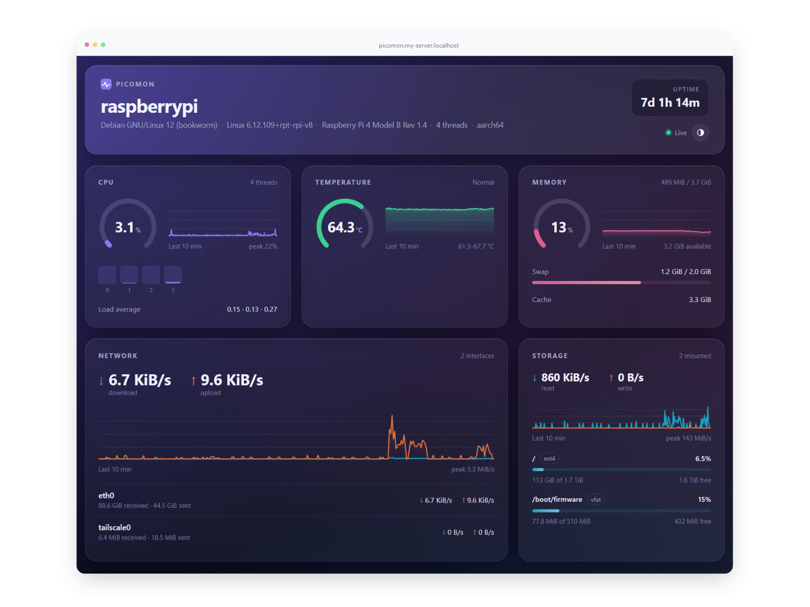

# Picomon

Lightweight self-hosted monitor for a single Linux server, with a web dashboard. One binary, about 1.3 MB, using about 3 MB of RAM. Low resource footprint, ideal for personal servers, such as a Raspberry Pi.



Metrics:

- CPU usage, per-core usage and load average
- CPU temperature
- Memory and swap
- Disk usage per filesystem and disk throughput
- Network throughput per interface
- Host details: OS, kernel, architecture, CPU model, uptime

Metrics come straight from `/proc` and `/sys`. The last few minutes are kept in memory for charts. Nothing is written to disk.

## Install

Each [release](https://github.com/wolfika/picomon/releases) has static binaries for x86_64, aarch64 (64-bit Raspberry Pi OS) and armv7 (32-bit Raspberry Pi OS). They have no dependencies and run on any distribution.

```sh
ARCH=$(uname -m | sed 's/armv7l/armv7/')
curl -fLO https://github.com/wolfika/picomon/releases/latest/download/picomon-linux-$ARCH
sudo install -m755 picomon-linux-$ARCH /usr/local/bin/picomon
picomon --print-config | sudo install -Dm600 /dev/stdin /etc/picomon/config.toml
picomon --print-service | sudo tee /etc/systemd/system/picomon.service >/dev/null
sudo systemctl enable --now picomon
```

The dashboard is served at `http://<host>:7340`.

The service reads `/etc/picomon/config.toml`, so the file must exist even when every key is left at its default.

To verify the download, fetch the checksums from the same release:

```sh
curl -fLO https://github.com/wolfika/picomon/releases/latest/download/SHA256SUMS
sha256sum -c --ignore-missing SHA256SUMS
```

### Build from source

Build requirements: stable Rust and [Bun](https://bun.sh).

```sh
make build                 # binary at target/release/picomon
sudo make install          # binary, systemd unit, /etc/picomon/config.toml
sudo systemctl enable --now picomon
```

Run `make build` as the user that has Rust and Bun installed. `make install` only copies the built files and does not need either toolchain. It copies the example config only if `/etc/picomon/config.toml` does not already exist.

## Update

```sh
ARCH=$(uname -m | sed 's/armv7l/armv7/')
curl -fLO https://github.com/wolfika/picomon/releases/latest/download/picomon-linux-$ARCH
sudo install -m755 picomon-linux-$ARCH /usr/local/bin/picomon
picomon --print-service | sudo tee /etc/systemd/system/picomon.service >/dev/null
sudo systemctl daemon-reload
sudo systemctl restart picomon
```

Regenerating the unit picks up any changes to it in the new version. The config file is left as it is.

From source, replace the first three lines with `git pull`, `make build` and `sudo make install`.

If the service fails to start, `journalctl -u picomon -n 20` shows why. A config key that the new version no longer accepts is named there. Compare with `picomon --print-config`.

## Configuration

Picomon reads its config from, in order:

1. `--config <path>`
2. `$PICOMON_CONFIG`
3. `/etc/picomon/config.toml`, if it exists

With no config file, defaults are used. `picomon --print-config` prints the annotated defaults. Unknown keys are rejected at startup.

### Authentication

Setting `auth.username` and `auth.password` enables HTTP basic auth on every route. Basic auth sends credentials in clear text. Put Picomon behind a reverse proxy with TLS when it is reachable from untrusted networks. Alternatively, set `listen = "127.0.0.1:7340"` and let the proxy handle both TLS and auth.

The systemd unit reads the config as a root-only credential, so the file can stay at mode 600.

### CPU temperature

The sensor is detected from hwmon (`coretemp`, `k10temp`, `zenpower`, `cpu_thermal`, …), with thermal zones as the fallback. The detected path is logged at startup. Set `cpu.temp_sensor` if the wrong sensor is picked. The temperature card is hidden when no sensor exists, which is typical in VMs and containers.

### Themes

`theme.preset` selects a built-in theme:

- `glass` (default), `dark`, `light`, `nord`
- `catppuccin-latte`, `catppuccin-frappe`, `catppuccin-macchiato`, `catppuccin-mocha`, using the [Catppuccin](https://catppuccin.com) palette

`[theme.colors]` overrides any theme variable; keys are CSS variable names without the leading `--`:

| Variable                                        | Used for                                                          |
| ----------------------------------------------- | ----------------------------------------------------------------- |
| `bg`, `bg-image`                                | Page background                                                   |
| `surface`, `border`, `shadow`, `blur`, `radius` | Cards                                                             |
| `hero`                                          | Header card background, layered over `surface`                    |
| `text`, `muted`, `faint`                        | Text, from strongest to weakest                                   |
| `grid`, `tooltip`                               | Chart gridlines, tooltip and menu background                      |
| `accent`                                        | Brand mark and focus rings                                        |
| `on-accent`                                     | Line drawn on `accent` in the brand mark; white when unset        |
| `cpu`, `mem`                                    | CPU and memory gauges and charts                                  |
| `series-1`, `series-2`                          | Download/upload and read/write; `series-1` also fills disk meters |
| `ok`, `warn`, `crit`                            | Status colours, including the temperature gauge                   |

Viewers can switch theme from the menu button in the page header. The choice is stored in their browser.

## API

| Endpoint          | Description                                                                                        |
| ----------------- | -------------------------------------------------------------------------------------------------- |
| `GET /api/sample` | Latest sample as JSON                                                                              |
| `GET /api/stream` | Server-Sent Events. An `init` event with host info and history, then a `sample` event per interval |

## Development

```sh
make dev     # backend on :7340, Vite with hot reload on :5173
make test    # Rust tests and Svelte type check
```

## License

MIT. See [LICENSE](LICENSE).
